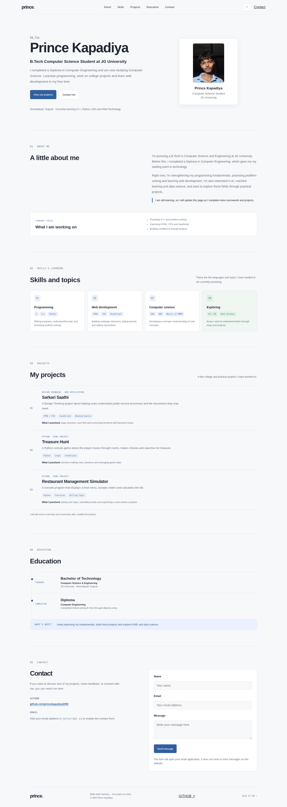

# Prince Kapadiya - Personal Portfolio

This is my personal portfolio website created for the Web Technology project. It introduces me, shows the topics I am learning, and gives a short overview of some college and practice projects.

## Website preview

## Built with

- HTML5 for the page structure
- CSS3 for styling, layout and responsive design
- JavaScript for interactive features
- Google Fonts: Lato and Roboto Mono

## Main sections

- Home and introduction
- About me
- Skills and learning topics
- Projects
- Education
- Contact form

## JavaScript features

- Dark mode toggle
- Mobile navigation menu
- Basic contact form validation
- Automatically updated footer year

## Run the website

1. Download or clone this repository.
2. Open the project folder in Visual Studio Code.
3. Open `index.html` in a browser. You can also use the Live Server extension.

No build tools or package installation are required.

## Profile photo

My profile photo is saved as `images/prince.jpg`. To change it, replace that image while keeping the same filename, or update the image path in `index.html`.

## Contact form note

The form checks the entered name, email and message. To enable the email action, replace `YOUR_EMAIL@example.com` in `js/script.js` with the email address you want to receive messages at. The form opens the visitor's default email application; it does not store messages or send them through a website server.

## Before publishing

- Check the personal details and project descriptions.
- Add source-code links to projects when those repositories are ready.
- Replace the placeholder email address in `js/script.js`.
- Test the layout on desktop and mobile screens.

## GitHub Pages

To publish: open the repository's **Settings → Pages**, select **Deploy from a branch**, choose `main` and `/ (root)`, then save. Wait for GitHub Pages to publish the site.
